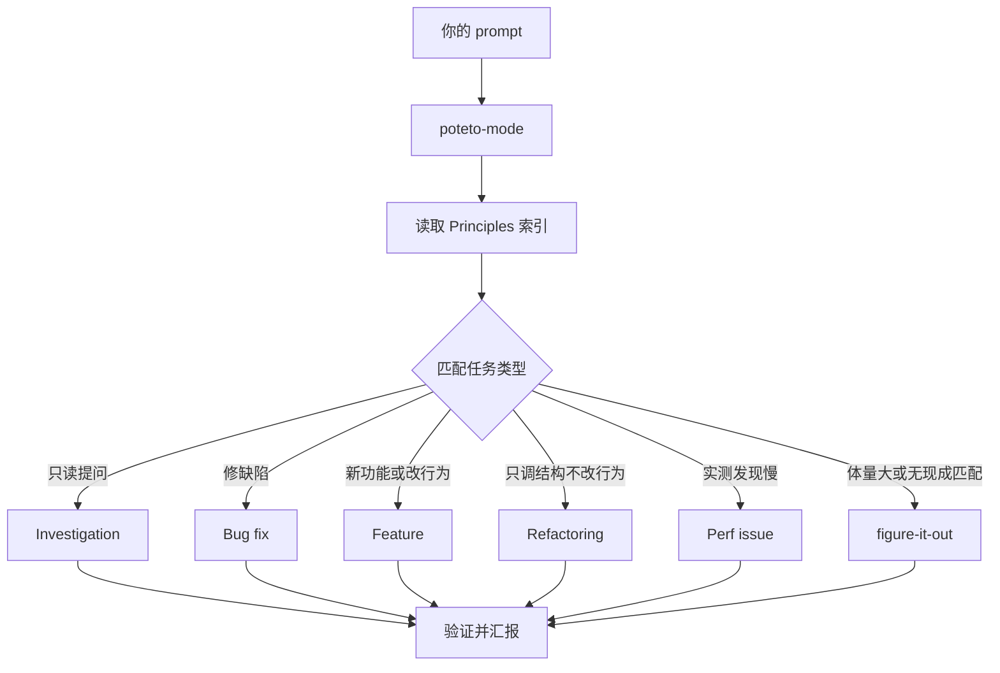

# 用 `/poteto-mode` 统领任务

`/poteto-mode` 是整个插件的总入口。你给它一个目标，它会匹配内置的 23 个 `playbook` 之一，把对应步骤抄进待办清单，并在跑每一步时自动调起需要的其他 `skill`。这一页讲清楚一条好 `prompt` 长什么样，以及其实根本不需要写多长。


## 你的 `prompt` 会经历什么



上图只画了最常用的几条路。除此之外，插件里还备齐了针对单指标迭代优化（`Hillclimb`）、活进程或性能产物取证（`Runtime forensics` / `Trace forensics`）、低成本原型比选（`Prototype`）、像素级 UI 对齐（`Visual parity`）、编写与盲测 `skill`（`Authoring a skill` / `Eval`）、无人值守长跑（`Autonomous run`）、开 PR 与盯盘护航（`Opening a PR` / `Babysit`）、叠栈 PR 合入主干（`Shipping`）、队列或叠栈全自动推进（`Autopilot-full` / `Autopilot-stack`）、项目级协调编排（`Orchestrate`）、断点续接与安全挂起（`Session pickup` / `Pause safely`）、多阶段计划（`Multi-phase plan`）以及清理 `worktree`（`Worktree cleanup`）的 `playbook`。完整清单见 [playbook 目录](../../skills/poteto-mode/playbooks/)。

## 直接说目标，省去繁琐形式

你不需要先写一份正经八百的规格说明书。直说哪里坏了、想做成什么样，再顺手带上你已经知道的线索，帮代理省去瞎找的时间就行：

```text
/poteto-mode 重试之后用户会收到两条重复通知。先复现，再修复并验证。
```

这就是一条典型的 `Bug fix` 任务 `prompt`。「先复现」不是客套话，而是硬约束，`playbook` 会严格照办。接下来你会看到待办清单里自动填满 `Bug fix` 的步骤；哪一步如果跳过，清单里也会留着并写上 `skip: <原因>`。

## 一条好 `prompt` 最多装这五件事

每件事用一句话就能交代清楚：

- **目标**：哪里出了问题，或者你想新加什么行为。
- **完成判定**：必须能明确测出「过」或「没过」。「把它弄好点」「干一个小时」都不算判定条件。
- **你想看什么证据**：直接要真实命令输出、操作录屏、落库后的实际值，或者优化前后的实测对比数。
- **你已经知道的线索**：报错现象、复现步骤、某行日志或相关链接，都能替代理省掉一轮排查。
- **硬性约束**：「先复现」「先别改代码」「零行为变化」「继续前先让我看一眼」，每一句都会实打实改变代理接下来的动作。

一条集齐这五件事的 `prompt` 长这样：

```text
/poteto-mode 从昨天发版后 CSV 导出会漏掉最后一行，失败任务 ID 是 4812。先复现再修。完成标准是 6 万行测试数据一行不漏全部导出，把修复前后的行数对比发给我。
```

有两样东西反而建议先别写进去：

- **具体怎么实现**：说清楚要达成什么结果就行，给代理留出余地去发现比你第一反应更好的解法。也不要在里面手动指定一串 `skill`（原因见文末避坑）。
- **你猜的根因**：一上来就说出猜测，会把代理的搜索视野框死在你指的地方。先让它用自己的话把问题复述清楚，再聊你的直觉。

遇到信息很杂的反馈（比如长长的讨论串或描述模糊的 bug），干脆把「复述问题」当成第一步：

```text
/poteto-mode 读一下这个讨论串，用大白话复述到底出了什么问题。先别改代码。
```

代理要是理解错了，复述时当场就能看出来。这时候纠正它只花一条消息，省得写出一份错的修改再返工。如果只想让它单独复述一遍、不走 `playbook`，直接调用 [`/in-your-own-words`](../../skills/in-your-own-words/SKILL.md)，它会把理解到的目标和核心问题原原本本讲给你听。

拿不准自己写的 `prompt` 问法对不对，发出去之前可以先过一遍 [`/sharpen`](../../skills/sharpen/SKILL.md)：

```text
/sharpen 给 v2 配置格式写一份迁移指南。
```

代理会先点出四件事：这个领域的顶尖专家会额外做哪些你没提的动作、他们会从哪份最原始的材料看起、会动用什么具体方法和工具，以及除了你和代理之外还有什么客观依据能证明结果是对的。然后它会把你的 `prompt` 重写一遍，挖得更深，但不扩大任务范围。重写后的 `prompt` 还会要求代理：凡是能靠跑实验定下来的分叉，先做原型观察再推荐方案；只有实验定不了的产品或偏好取舍，才留给你拍板。`/sharpen` 本身不会直接开工。你看完改好的 `prompt` 觉得合适，再配上 `/poteto-mode` 发出去就行。

## 上下文有了，后续指令越短越好

对话里已经攒够上下文时，后面的指令可以短到只剩几个字，下面这几种都够用：

```text
/poteto-mode 就这么办
```

```text
继续
```

```text
一直跑到完成为止
```

短指令能管用，是因为 `playbook` 在底层撑住了流程骨架，而 Custom Mode 会把 `/poteto-mode` 钉在每一轮对话的上下文里（开启方式见 [安装与配置](./01-setup.md#run-your-first-task)）。你只需用大白话表达意图，规矩和严谨性由 `skill` 兜底。

## 用「新任务」切换话题

聊久了，对话里满是上一件事的残留上下文。要换话题时，明确点出来：

```text
/poteto-mode 新任务。查一下为什么退出登录后缓存条目还在。先别改代码。
```

「新任务」会告诉 `/poteto-mode` 重新匹配 `playbook`，不要顺着上一套流程往下跑；「先别改代码」则会把这次钉在 `Investigation` 上。不加这两句的话，正处在 `Feature` 模式里的代理很容易把你的提问当成下一个开发步骤。

## 给并行干活的代理各自独立的环境

如果在一台电脑上同时开几个代理改同一个仓库，它们很快会抢工作区、抢端口、覆盖彼此的编译产物。最省心的隔离方案是 [云端代理（cloud subagent）](https://cursor.com/docs/subagents#cloud-subagents)。每个云端代理都有自己的虚拟机和分支，装依赖、起服务、录验证视频全都不碰你本地机器。任务前加上 `/in-cloud`，或者直接让主会话把活派给云端代理就行。

如果工作必须留在本地跑，提前叫代理开好 `worktree`：

```text
/poteto-mode 新任务。从 <base> 拉个新 worktree 建分支，把 parser 的改动迁过去。
```

每个任务独占自己的分支和 `worktree`，彼此才不会踩烂文件。`worktree` 吃磁盘和内存，一台笔记本同时最多开几个。代码类任务里的 [`Opening a PR`](../../skills/poteto-mode/playbooks/opening-a-pr.md) 本身就会主动用 `worktree` 干活，平时你只需要在指定特定 base 分支或目录位置时提一句。

时间久了 `worktree` 会越攒越多。磁盘紧张时问一句：

```text
/poteto-mode 什么东西占满了我的磁盘？把能安全清理的 worktree 删一删。
```

[`Worktree cleanup`](../../skills/poteto-mode/playbooks/worktree-cleanup.md) 会按合入状态、未提交改动以及近期还有哪些对话碰过它来逐一归类。证据确凿能清的才删，手里还攥着未提交改动的会停下来等你拍板。

## 挂机让它自己跑完

人要离开时，把完成标准交代清楚就能走：

```text
/poteto-mode 我先走开一下。一直跑到迁移检查报零个旧调用方为止，把做的每个决策记进日志。
```

这类你走开后回来再验收的任务，会自动路由给 [`/figure-it-out`](../../skills/figure-it-out/SKILL.md) 去拆解阶段，并挂上 [`/show-me-your-work`](../../skills/show-me-your-work/SKILL.md) 记决策日志。完整的过夜跑法见 [睡觉时让它接着干](./07-overnight.md)。

**避坑提醒：** 别在 `prompt` 里自己列一串 `skill` 顺序（「先用 `/architect`，再用 `/arena`，然后 `/interrogate`……」）。`playbook` 自己排好了顺序，人手写死反而经常把本来该跑的步骤打乱或漏掉。只有你想刻意覆盖某个默认选择时，才点名具体的 `skill`。

完整的路由规则可以直接读 [`poteto-mode`](../../skills/poteto-mode/SKILL.md) 原文。

下一篇：[先读懂代码](./03-understand.md)。
