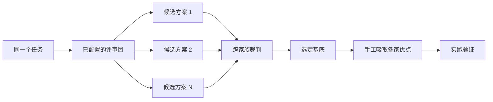

# 写代码前先敲定设计

碰到难搞的设计，只试一次往往就会被模型蹦出来的第一个形状锁死。`/architect` 在写代码前先把类型和模块边界敲定；`/arena` 拿同一份 `brief` 并行跑几套方案再取长补短；`/interrogate` 让其他模型轮番上阵试图把结果跑崩。如果任务拼的是覆盖面而不是综合出一份最佳设计，那就用 `/swarm` 把分片或赛马任务撒出去再收回一份汇总。

做设计最常踩的两个坑，一是直接拿代理给的第一个方案就开工，二是把一份一行代码都没验证过的书面计划反复打磨。这一页专治这两个毛病。核心做法是**用代码来规划**：靠原型回答悬而未决的问题，用 README 或使用教程定好外部目标，书面计划排在最后写。


## 用 `/architect` 先定形状

```text
/architect 写代码前先设计一下导入流水线。我最关心调用方用起来顺不顺手。
```

[`/architect`](../../skills/architect/SKILL.md) 先顺着代码把改动触及的每一个系统追一遍，再勾勒出两种不同的形态方案（各自包含类型、函数签名和模块边界），挑出满足「每份状态唯一归属、每项任务只有一种做法、调用方需要知道最少」的那一种。体量庞大或存在争议的设计，它会直接跑 `/arena`，而不是独自画草图。如果你想在写代码前先过一眼设计，在 `prompt` 里直说即可。

代码一写起来，最初的设计也不是神圣不可侵犯的。如果同一种绕路补丁反复出现，`/architect` 会直接重新设计，绝不继续打补丁。

## 用 `/arena` 并行跑多套方案

```text
/arena 把我这段 prompt 原封不动丢进 arena，我想拿它们的方案跟你的比一比。
```

[`/arena`](../../skills/arena/SKILL.md) 是背后那套通用机制。N 个子代理拿到完全相同的 `brief` 并行尝试设计或编码，各自写进独立的 `worktree` 或临时目录。等跑完后，由一位来自不同模型厂商的只读裁判按评分标准逐条打分；如果没有其他厂商的模型可用，总控会话会跳过裁判环节自己选基底。总控会话把每一份候选方案从头到尾读完，选定一个基底方案，再把落选方案里最棒的点子手工吸取合并进来，最后跑实证验证。



评审团名单来自你的 [`/setup-pstack`](../../skills/setup-pstack/SKILL.md) 配置，也可以按具体任务临时增减。决策代价高就多跑几个候选，小事就少跑几个：

```text
/arena 跑这个，开 5 个候选方案。缓存键格式一旦定下来以后改起来太贵。
```

## 用 `/swarm` 跑分片覆盖和赛马

```text
/swarm 把 packages/ 下面每个包都拿各自的 check.sh 验一遍。一包一个工人，给我汇总成一份报告。
```

[`/swarm`](../../skills/swarm/SKILL.md) 会把 N 个工人同时撒到独立分片、覆盖矩阵、多路闯关测试线、探索分区，或者事先定好规则的赛马分组上。每个工人领走自己的范围和检查任务，跑完汇报 `PASS`、`ISSUES` 或 `BLOCKED`。主会话等大家收齐后，吐出一份紧凑汇总，并标出漏项或中途掉线的工人。

只要并行的目的是铺开覆盖面，或者让独立检查赛马，就找 `/swarm`。区别很清楚：`/arena` 是所有人拿同一份设计或代码 `brief` 同题竞技，最后选基底再嫁接；`/swarm` 是拆片覆盖或按既定规则赛马，不走选基底和嫁接那套仪式。

## 用 `/interrogate` 试着把改动跑崩

```text
/interrogate 审一下整个分支，带着怀疑的眼光看。除非是真 bug 或行为回归，别报吹毛求疵的小毛病。
```

[`/interrogate`](../../skills/interrogate/SKILL.md) 会把代码改动和它的设计意图交给配置好的各路对抗评审代理，每个代理都试图对着真实代码把改动跑崩。不同模型抓出来的漏洞往往不一样。一条查出的问题只有靠重跑它给出的命令、并且输出确实违背了设计意图，才能存活下来。最终报告会列出每一条经过验证的缺陷以及是哪些对抗代理发现的，同时列出每个代理被刷掉的条目及原因，且全程不会擅自改代码。

被刷掉的 `Dropped` 列表也值得扫一眼，你随时可以推翻判定结论。

## 用原型说话，别靠嘴争论

永远别直接接受第一个设计。多要几个方案，看着真实跑出来的东西挑：

```text
/poteto-mode 给新的下拉菜单做几个原型方案，录屏或截图给我对比。
```

[Prototype playbook](../../skills/poteto-mode/playbooks/prototype.md) 会在临时目录里搭几份用完即弃的草样，把不同变体挂在同一个切换开关后面，逐个跑一遍，并截好图或记下耗时。它不只适用于 UI，行为逻辑和算法比选一样好用。做原型就是用代码做规划：代理不用老跑来问你，靠自己跑一跑就能定下悬而未决的问题，顺带还能撞出你本来没想到的解法。

这套思路放大到严肃架构设计上同样管用，把 `/architect` 和原型绑在一起，再加一道人工审批卡点：

```text
/poteto-mode 我们需要给外部 webhook 加限流。先 /architect 出设计，拿不准的问题做原型验证。继续实现前先让我看一眼。
```

别拿对抗评审代理去审一份空泛的书面计划。`/interrogate` 会把没跑出实证的条目全刷掉，背后没代码撑着的计划根本没东西让它们攻破。先让原型把疑问钉死，等真东西造出来再拿去挑刺。

## 共享代码先写 README

如果要做一个给别人调用的包或 API，先从用户会读的那篇文档写起：

```text
/poteto-mode 先写一篇教程，示范我该怎么用这个新的 config 包。然后 /teach 我它为什么比现在这套强。
```

先写教程能逼着你站在调用方视角思考：向一个假想用户讲清楚 API 怎么用，再倒推出内部实现。写好的文档也会变成具体靶子，方便代理事后拿代码反过来对照检查。如果文档本身很关键，直接点名 [`/technical-writing`](../../skills/technical-writing/SKILL.md)，防止教程写着写着串味成参考手册和原理科普大杂烩。

## 等设计定了，再写计划

`pstack` 刻意没做专门的规划 `skill`。等设计真正落定了，真想要一份书面计划时再开口要：

```text
/poteto-mode 把这份设计转成实施计划。拆成小步可验证的 PR，每个 PR 配好自己的验证步骤。
```

[Multi-phase plan playbook](../../skills/poteto-mode/playbooks/multi-phase-plan.md) 会先用原型把剩下的开放问题清掉，然后按每个 PR 写一节，每一节末尾必须写明怎么证明改动真的生效（光跑过测试套件不算数）。计划本身就是交付物，这套 `playbook` 不会直接动手写业务代码，只有你明确放行后才会启动执行。

如果是做迁移，把验收红线直接写进 `prompt`：

```text
/poteto-mode 规划把我们的 UI 库迁到新样式系统。拆成小步可验证的 PR，每个都带视觉回归检查。结果必须跟原版严丝合缝，连原有 bug 都要原样保留。
```

加上「连原有 bug 都要原样保留」，能防着迁移顺手暗改行为，免得新旧输出对不上号。横跨好几天的大工程，可以把计划文件先临时提交进仓库方便其他代理查看进度，等活全部合入后再删掉。

## 一项任务到底值多少设计投入？

你可能会问，难道每次改代码都要走完这一整套？当然不是，大多数改动根本用不着。大致分这几个台阶：

- 一个拿不准的小改动，单独跑一次 `/interrogate` 就够。
- 跨函数边界或要挪动模块归属权的改动，值得上 `/architect`（设计体量大或存在争议时会自动带出 `/arena`）。
- 命名、数据格式或算法这类适合多路独立尝试的局部决策，直接跑 `/arena`。
- 需要铺开覆盖矩阵、跑一组并行检查或定好规则赛马的，用 `/swarm`。
- 布局、耗时或方案选型这类跑一下就能看到结果的开放疑问，做个原型，别干辩。
- 存在明显争议、事后返工代价极高的设计，先 `/architect`，交付前再 `/interrogate`。
- 横跨好几个 PR 的大工程，等设计定稳后再补一份实施计划。

`/poteto-mode` 本身就内置了这个阶梯。跨边界改动会自动触发 `/architect`，所以平时只有在你想比默认更严或更轻时，才需要手动点名这些 `skill`。

下一篇：[开发实现与清理 diff](./05-build-and-clean.md)。
