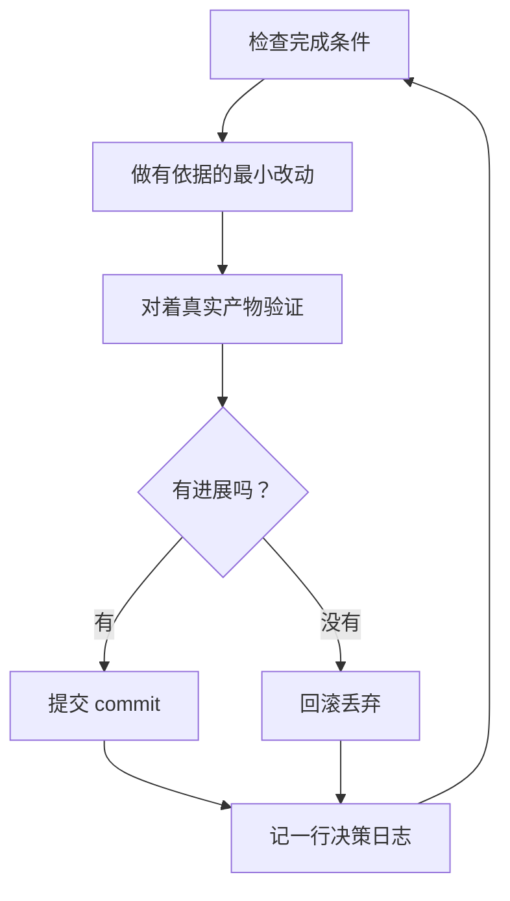

# 睡觉时让它接着干

前面铺垫的一切，最后都是为了换来这一步。一个能自己把活验明白的代理，你才敢把硬骨头丢给它自己跑。让这件事真正稳妥的不是盲目祈祷，而是三样实打实的保障：一个能判真假的完成条件、隔离好的 `worktree` 或云端代理，以及一份早上醒来就能快速复查的决策日志。


## 先挣够信任，再开循环

一个你不放心的循环，只会以更快的速度批量制造没人验过的烂摊子，而且每跑一轮乱子越滚越大。撒手让它过夜前，先确认这四条都成立：

- 你自己亲手干过一遍同类任务，或者盯着代理完整跑过一遍，心里清楚「合格」长什么样。
- 代理手里握着你自己排查时会用的全套工具和信号：验证 `skill`、性能分析器、日志。
- 流水线上的每一个阶段都能自证过关，一旦不达标就敢立即叫停。
- 你已经抽读过几份历史对话记录，把代理反复踩的坑做成了工具、`skill` 或自动检查。

四条全齐了，再把循环放成全自动。在此之前，先在眼皮底下盯着跑。

## 无人值守交接约定

一份靠谱的过夜交接包含四样东西：目标、完成条件、提前给好的权限，以及止损退出条件。并不需要写多长：

```text
/poteto-mode 我去睡了。从 <base> 拉个新 worktree，把所有调用方迁到新 parser。
完成标准是旧调用方清零、所有 parser 测试用例通过、旧 API 删干净。
记好决策日志。提交 commit 前不用问我。
/loop 直到完成为止。如果跑了几个小时确实卡死在死胡同里，停下来把原因写清楚。
```

拆开看每一行到底换来了什么：

- 「我去睡了」是一条会话级覆写指令，代理不再停下来请示，直接往下推。
- 「完成标准是……」把抽象目标变成了每一轮都能跑出对错的硬检查。
- 「从 `<base>` 拉个新 worktree」防止它跟你本地正在干的其他活撞车。
- 「提交 commit 前不用问我」把代理原本会停下来等确认的权限提前放行。
- `/loop` 是 Cursor 内置的定时唤醒机制，不是 `pstack` 的 `skill`。[Autonomous run playbook](../../skills/poteto-mode/playbooks/autonomous-run.md) 靠它在事件触发或心跳间隔时重新检查完成条件。
- 止损退出条件允许它在遇到真正死路时体面停手并写明卡点，总比它通宵八小时自己偷偷篡改目标强。

因为这是你走开后回来再审的活，`/poteto-mode` 会自动把它交给 [`/figure-it-out`](../../skills/figure-it-out/SKILL.md)，在写代码前先拆好阶段，并把决策日志挂进流程。

如果想中途主动叫停，直接告诉代理暂停，或者说你要下线、要重启 Cursor。[Pause safely playbook](../../skills/poteto-mode/playbooks/pause-safely.md) 会把当前这一步收尾或回退干净，提交一个 WIP checkpoint，并写好恢复说明。下次新开对话，靠 `Session pickup` playbook 读这份说明就能无缝接上。注意说「继续（keep going）」绝不会触发暂停。

## 循环一整晚到底在干什么



每一轮循环都严守同一节奏：改一处、验一次、记一行日志。没带来收益的改动直接回滚丢掉，绝不留着凑数。遇到平台期就换思路转向，而不是干脆躺平停工，更绝不允许悄悄放宽完成标准来宣布胜利。

## 第二天早上的验收审计

[`/show-me-your-work`](../../skills/show-me-your-work/SKILL.md) 让整晚的自动运行变得可审查。每一行记录着时间、阶段、决策内容、理由、证据指针和结果，存成 TSV 文件，路径为 `decisions.tsv`（同一目录下并跑多个任务时存在 `.audit/<task-slug>.tsv`）。默认留在本地不提交；如果任务分量很重、评审人需要看到完整轨迹才敢放行，就把它一起提交进仓库。

早上回来后，直接让它按审计视角汇报：

```text
/show-me-your-work 给我过一遍你昨晚干了什么
```

交回总结之前，这个 `skill` 会另派一个不同模型家族的审查代理通读决策日志和完整对话记录，最后在回复末尾单列一个 **Attention** 小节，标出最值得你亲自细看的地方。你先看这一节，再顺着它指出的日志行去查。你要审的是关键决策，不是把一整晚的流水账从头读到尾。

如果只想要一份简明进度同步、不用大动干戈做审计，直接在跑活的对话里敲 [`/ketchup`](../../skills/ketchup/SKILL.md)。它全程只读，用大白话告诉你自上一条消息以来发生了什么变化，顺手附上期间产出的截图和小图；接着把每一项等你拍板的事（比如合 PR、审批、方案二选一）列齐，每项带上它的推荐选法、实证依据和风险，让你只看这一条回复就能做完所有决定。

## 当过夜的不是单个任务，而是一整条队列

上面的约定适合把单个任务推到单个完成条件。但有些晚上你要处理的是多个独立改动，甚至一整项跨天大工程。下面两个 `playbook` 外加一个 `skill` 把同样的信任机制往上放大。

[Autopilot-full](../../skills/poteto-mode/playbooks/autopilot-full.md) 负责把一条独立 PR 队列一路跑到全部合入。每个 PR 配一名主理代理从开发带到合入，且任何主理代理都不能靠自己拍板就合并。代码就绪后，由一组全新的验证 `swarm` 对这个 head 做独立验证；后续如果只是变基或小修，补派一名全新验证代理重验即可，只有加了新行为或改动幅度很大时才重新拉起整组 `swarm`。只有最终落地的这份补丁拿到干净的通过结论，才放行合入：

```text
/poteto-mode 这条队列跑 full autopilot，每项彼此独立，明早我要看到它们全合进去。
```

[Autopilot-stack](../../skills/poteto-mode/playbooks/autopilot-stack.md) 就是去掉合入动作的 `Autopilot-full`。你睡醒后会看到一排已经验完、各自带着判定结论的 PR，留给你自己审完再合入。只有确实建立在前一个 PR 之上的改动才会叠栈，不瞎叠。想在真正合入主干前自己把最后一道眼关，就选它：

```text
/poteto-mode 这五个改动跑 autopilot，但别点 merge，明早我自己来合。
```

像跨多包迁移这种整项大工程没有专属 `playbook`。`/poteto-mode` 会把体量庞大或跨切面极广的工作路由给 [`/figure-it-out`](../../skills/figure-it-out/SKILL.md)，由它量身设计一套严谨执行流程：

```text
/poteto-mode 把所有包都迁到新 store，一直跟到每个包都迁完合入为止，我每天来看两次进度。
```

## 并行推进多个 Project

[Cursor Project](https://cursor.com/blog/projects) 给总控代理提供了一条持久主线。总控不亲自写代码，只管指挥子代理；子代理默认跑在云端，哪怕你合上笔记本，活也照样往下推。发给总控的 `prompt` 用 `/poteto-mode` 开头，它派出去的子代理就会自动遵守全套 `playbook`。它启动的每一个代理都会先读 [`worker.md`](../../skills/poteto-mode/worker.md)，因此所有 worker 都会严守启动说明里的验收标准、自行拍板可撤回的决定而不来打扰你，并直接以 ready for review 状态打开 PR。

几条好用的实战习惯：

- 按大块工作拆开建 Project（比如一个新功能、一次迁移、一轮性能优化、一轮技术债清理），多个 Project 并排推进。
- 把相关对话（包括已经结束的历史对话）拖进同一个 Project，它们会直接变成里面所有代理的共享背景。
- 每个 PR 合入前都过一遍验证 `swarm`，让 `Autopilot-stack` 或 `Autopilot-full` 扛着整条队列跑。
- 让总控拿出有真实数据撑腰的计划，碰到拿不准的问题先做原型验证，别动不动跑来问你。

一条 `prompt` 就能把整个 Project 从前期摸底一路推到落地执行：

```text
/poteto-mode 重构这个仓库，让它的架构对 agent 更友好。对着历史 commit 和评审评论跑 /correct 和 /architect，找出代理在这里最常犯的错误。用 /recall 找回旧对话里的上下文。有开放问题自己做原型验证，别问我。拿出一份有真实数据支撑的计划。我批了之后再决定走 autopilot-stack 还是 autopilot-full，到时候问我选哪个。
```

## 让循环自己按事件启动

前面所有循环都还得你手动敲一句才开跑。换成定时任务或事件驱动自动化，连这一步也能省掉。软件日常维护天然适合拆成几段流水线：分诊问题单、复现 bug、写修复、验证修复。两条纪律能让这条自动流水线一直靠谱：

- 每一站都有权立即叫停整条线。分诊站可以判定这是预期行为，复现站可以回报无法复现，修复站可以判断改动风险太大。这些拦截全都有价值，它们把坏活挡在原地，防止流到下一站后返工代价翻倍。
- 每一站交接都必须带证据。复现站附上出错现场的截图和视频，修复站附上前后对比实证。真人在读一行代码之前，就能先一眼确认代理修的到底是不是正主。

`pstack` 把这套机制打包成了一套默认休眠的 [Benny 自动化包](../../automations/benny/README.md)，专门处理 Slack 上的问题反馈。一条自动化负责分诊反馈，另一条负责复现确认的 bug 并视情况准备一份小改动草案。把代理指向里面的 [`FOR_AGENTS.md`](../../automations/benny/FOR_AGENTS.md) 并告诉它目标仓库名就能配起来。

**避坑提醒：** 时长不是完成条件。「在这件事上干 4 个小时」没给代理任何能验真假的靶子，你睡醒后只会得到四小时的忙碌痕迹，而不是结果。给 `/loop` 的必须是能明确判「通过」或「未通过」的条件。

下一篇：[用 `principle` 名称中途纠偏](./08-principles.md)。
